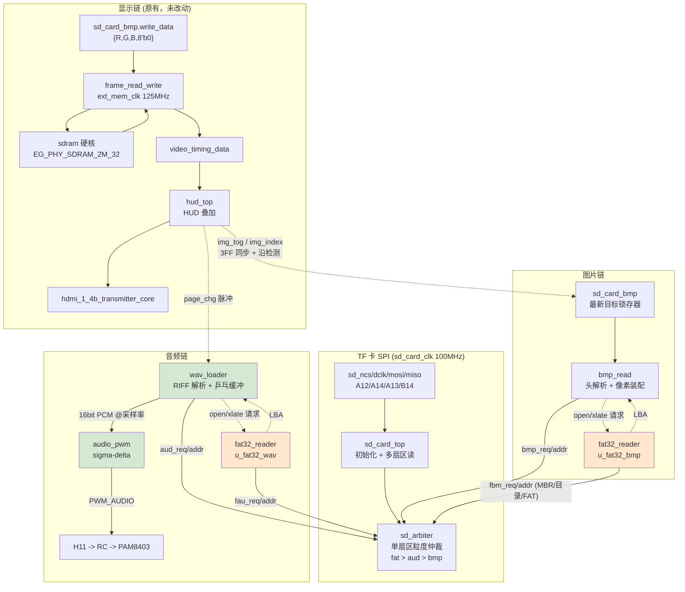

# FAT32 按文件名读图 + WAV→PWM 改造说明

本次改造把原来「固定 LBA 裸扇区直读」的图片/音频链路，换成「FAT32 按文件名读取」，
并把音频出口从 HDMI 内嵌 I2S 换成 H11 上的 PWM 功放输出。

**改动前先把要动的文件备份到了 `_fat32_backup/`**（这个工程没有 git）。
要整体回退，把那个目录里的 7 个文件覆盖回去即可。

---

## 1. 改了哪些文件

### 新增

| 文件 | 作用 |
|---|---|
| `src/fat32_reader.v` | FAT32 只读：按文件名打开 + 「文件内第 N 扇区 → 绝对 LBA」 |
| `src/wav_loader.v` | 打开 WAV、走 RIFF chunk 链、流式送出 16bit PCM |
| `src/audio_pwm.v` | 16bit PCM → 1 位一阶 sigma-delta PWM |
| `tools/chk_drivers.py` | 多驱动检查器（见第 8 节） |

### 改造

| 文件 | 改了什么 |
|---|---|
| `src/bmp_read.v` | 地址从「算出来的常量」改成「向 fat32 查」。状态机/头部解析/像素装配**一行没动** |
| `src/sd_card_bmp.v` | 多一组到 fat32 的透传端口 |
| `src/sd_arbiter.v` | 请求方从 2 个（bmp/aud）扩到 4 个（+FAT 元数据读 ×2） |
| `src/top.v` | 例化两个 `fat32_reader` + `wav_loader` + `audio_pwm`；删除旧音频链和蜂鸣器 |
| `top.adc` | `buzzer` → `pwm_audio`，仍绑 H11，附 RC/功放接线说明 |
| `pic_sdram.al` | 加入 3 个新文件，移除 `audio_sd_reader.v` / `audio_fifo.v` |

### 移除（`.v` 文件仍在盘上，只是不再参与编译）

`audio_sd_reader.v`、`audio_fifo.v`、`buzzer_beep.v`（后者其实早就没被例化以外的使用了）。

> **`u_audio_tone` / `u_i2s_rx` / `u_audio_arc` 三条 HDMI 内嵌音频链保留了。**
> 原因：厂商 HDMI 核的音频端口不能悬空，整条删掉要冒动到核的风险。
> 现在 `pcm_data` 恒为 0，所以 HDMI 里只剩 `u_audio_tone` 内部合成的报警提示音，
> 语音播报全部走 H11。等你确认 HDMI 那路确实不需要了，再把这三块删掉、把
> 核的音频输入直接接 0 即可。

---

## 2. TF 卡准备

1. 用 Windows 格式化 TF 卡为 **FAT32**，分配单元大小用**默认**（不要手动指定）。
2. 把 12 个文件一次性拷到**卡根目录**：

   ```
   01.BMP  02.BMP  03.BMP  04.BMP  05.BMP  06.BMP
   01.WAV  02.WAV  03.WAV  04.WAV  05.WAV  06.WAV
   ```

   页 -> 文件是**一一对应**的：`hud_data_gen.v:330` 的 `o_img_index = disp_page`，
   经 `bmp_read.v:410` 的 `f_file_idx <= {1'b0, img_index}` 落到 `0(N+1).BMP`；
   音频同理（`wav_loader.v:329` 的 `f_file_idx <= frag_idx + 4'd6`）。
   ⇒ **页 N 一定取 `0(N+1).BMP` / `0(N+1).WAV`**，所以"某张图要出现在某页"
   这件事只由**文件名**决定，RTL 一行都不用改。

   | 页 | 界面 | 底图 | 来源 | 颜色 |
   |---|---|---|---|---|
   | 0 | 三表总览 | `01.BMP` | `01.png` | 白色储罐（实景照） |
   | 1 | 压力放大 | `02.BMP` | `03.png` | 浅蓝 |
   | 2 | 温度放大 | `03.BMP` | `04.png` | 绿色 |
   | 3 | 液位放大 | `04.BMP` | `05.png` | 深蓝 |
   | 4 | 待机巡检 | `05.BMP` | `06.png` | 橙色 |
   | 5 | 储气罐故障 | `06.BMP` | `02.png` | ★红色 = 报警页★ |

   > 顺序由 `tools/real_assets.py` 里的 **`PAGE_IMG_SRC`** 一个常量决定
   > （下标=页号，值=源素材编号），改完重跑脚本即可。
   > `0N.WAV` 是**页 N 的播报**，不跟着底图跑 —— 换底图不动音频编号。
   > 万一你那六段其实是"第 N 张图"的解说，把同一文件里的
   > `WAV_FOLLOW_IMG` 改成 `True` 重跑，图挪到哪音频跟到哪。

3. **文件名必须是 8.3 短名**：纯数字/英文、无中文、无空格。
   长文件名在目录里是 `0x0F` 属性项 + 一个 8.3 别名，本模块会跳过 LFN 项直接比
   短名域，所以**恰好也能工作**——但别名可能是 `01~1.BMP` 这种，就对不上了。
   稳妥做法是拷进去之后在 `cmd` 里 `dir /x` 看一眼短名。
4. **防碎片**：格式化后**第一批就拷这 12 个文件**。
   代码支持 FAT 链跟随（不假设连续），但碎片会让每跨一个碎块就多读一次 FAT 表，
   读图会变慢。
5. 音频规格：**PCM / 16bit / 单声道**。采样率支持
   8k / 11.025k / 16k / 22.05k / 24k / 32k / 44.1k / 48k；
   不在这张表里的会按 16kHz 播放并把 `rate_ok` 拉低（诊断位）。
   注意采样率是从 WAV 头里**读出来的**，不像旧版那样写死 48kHz。
6. 图片规格：640×480、24 位、未压缩（`biCompression=0`）、BGR 顺序、
   自下而上存储。头里的宽度必须等于 640，否则 `bmp_read` 会判定为头部非法并
   保持上一帧（数码管 `state_code` 停在 2）。

> **和旧版最大的区别：不再需要 `tools/layout_sd.py` 生成镜像、也不需要用
> 裸扇区方式写卡。** 卡就是一张普通的 FAT32 卡，资源管理器拖进去就行。
> `bmp_read` 里 `IMG_BASE_SEC` / `IMG_STRIDE` 两个参数已经删掉了。

---

## 3. 功放接线

```
                                    +---------+
   H11 ──[100Ω]──┬─────────────────►│ IN+     │
                 │                  │         │
              [0.1µF]               │ PAM8403 │──► 喇叭
                 │                  │         │
                GND ───────────────►│ IN-  GND│
                                    +---------+
                                       ▲
                                      5V 供电
```

* 板上 H11 后面**已经有蜂鸣器，不用拆**。PWM 同时驱动它，语音播放时它最多
  顺带出一点声，不影响功放和喇叭。
* **RC 一定要接。** 不接的话 PAM8403 输入端吃到的是 100MHz 的方波边沿。
* 100Ω + 0.1µF 的截止频率是 `1/(2π·100·1e-7) ≈ 15.9kHz`。
  **这个 RC 是配合 `audio_pwm` 里的一阶 sigma-delta 设计的**：
  sigma-delta 把量化噪声整形成 f² 推到高频，15.9kHz 的一阶低通就能滤干净。
  如果换成朴素的计数器 PWM（16bit 分辨率下载波只有 1.53kHz），同一个 RC
  根本滤不掉载波，喇叭里会是明显的啸叫。详见 `src/audio_pwm.v` 文件头。
* 3.3V LVCMOS 直连 PAM8403 输入，不需要电平转换。

---

## 4. 模块连接框图



---

## 5. 分步调试与预期

**每一步只改动一处，上板看现象，通过了再进下一步。** 一上来就全长跑通，
出问题时无法定位是哪一段。

### ① SPI / TF 卡初始化

综合下载后，`sd_card_top.sd_init_done` 用 ILA 抓，上电约 100ms 内应该拉高。
不拉高见排查表第 1 条。这一步和改造无关，旧工程能跑就说明没问题。

### ② 读 MBR / 引导扇区，核对分区参数

把 `u_fat32_bmp` 的 `state_code` 引到数码管（或 ILA）：
`1`=空闲 `2`=读 MBR `3`=读引导扇区 `4`=读目录 `5`=目录跨簇 `6`=打开结束
`7`=翻译判断 `8`=读 FAT 项 `9`=翻译结束。

**核对**（用 `HxD` 之类的工具看卡的前几个扇区）：

* 分区表项的类型字节应该是 `0x0B` 或 `0x0C`；起始 LBA 记下来，
  和第 3 步 `state_code` 停在 3 时 ILA 看到的 `fat_addr` 一致。
* 引导扇区偏移 `0x0D` 是每簇扇区数。Windows 对 4~8GB 的卡一般是 `0x08`（4KB/簇）。
  `0x0E` 保留扇区数一般 `0x20` 以上，`0x10` FAT 份数一般为 2。
* `0x24` 的 FAT 大小 × 2 + 保留扇区数 + 分区起始 = 数据区起点，
  应该 < 分区起始 + 分区扇区数。

### ③ 列根目录，找到 01.BMP

`state_code` 停在 4/6，`u_fat32_bmp.found` 应为 1。
在 `S_OPEN_END` 那一拍抓 `first_cluster`（一般为 2 起步的某个簇号）和
`file_size`（应为 **921654**）。

**`file_size` 是不是 921654 是这一步的关键判据** —— 对不上说明短名匹配错了，
很可能匹配到了别的文件或者 LFN 别名。

### ④ 加载单张 BMP 并全屏显示

只让上电读第 0 张（`first_find`），HUD 先不管。屏幕上应该出现 01.BMP。

**两个必须确认的点**：

* **上下不能颠倒。** BMP 是自下而上存的，`bmp_read` 输出的是「屏顶那行先出」，
  由 `frame_read_write` 的 `ROW_REVERSE(1)` 参数完成翻转。如果反了，
  查 `frame_read_write` 的 `ROW_REVERSE`。
* **颜色不能偏。** BMP 是 BGR 顺序，`bmp_read` 里装配成 `{R,G,B}`。
  出现三通道轮转（人脸发蓝之类）说明 `bmp_len_cnt_tmp` 那套字节对齐错了 ——
  注意 `pixel_data_start` 那拍是 `2'd1` 不是 `2'd0`，`bmp_read.v` 里有详细注释。

### ⑤ 六帧加载 + 按键切页

按 K2 翻页，`img_idx_sd` 变化 → `sd_card_bmp` 的「最新目标锁存器」触发读图。
连按两下应该**只读最后那一下对应的图**（中间那张直接跳过），这是设计语义。

### ⑥ WAV 解析与 PWM 播放

切页时 `u_wav_loader.state_code` 应该走
`0`→`1`→`2`→`3`→`4`→`5`→`6`（等播放）。
`wav_fmt_ok` 应为 1（PCM/单声道/16bit 三项都对）。
`wav_rate_ok` 应为 1（采样率在支持表内）。

喇叭里应该听到对应段落的语音。**如果全程无声**，先看 `fmt_ok` 和 `rate_ok`，
再看 `err`（打开失败或头非法）。

### ⑦ 同步与故障

切页时画面和语音应该同时切换（`page_chg_sd` 一个脉冲同时喂给 `bmp_find`
和 `wav_play`）。

> ⚠ **这一节和旧工程的行为不同，需要你确认**：旧版是「报警页不播报，只报警」，
> 现在的代码是「报警页也发 `play`，`frag_idx=5` 会译码成 06.WAV」。
> 也就是说**报警页会播 06.WAV**。这符合你 spec 里「故障→显示 06、播 06.WAV」的
> 描述，但和旧工程相反。如果要改回旧行为，把 `top.v` 里的
> `wire wav_play = page_chg_sd;` 改成 `page_chg_sd & ~is_alarm_page` 即可。
>
> 另外 spec 里的「每 5 秒重播 06.WAV」**没有实现** —— 需要在 `top.v` 加一个
> 5 秒计数器在报警页周期性发 `wav_play` 脉冲。没做是因为旧工程的报警语义是
> 「不播语音」，我不确定你要哪种，没有替你决定。

---

## 6. 排查表

| 现象 | 可能原因 | 怎么查 |
|---|---|---|
| `sd_init_done` 不拉高 | MISO 没上拉 / 卡座虚焊 / 卡是 exFAT | .adc 里 `sd_miso` 需要外部上拉；换一张确定 FAT32 的卡 |
| 初始化偶发失败 | CMD0 前时钟不足 74 拍 / 上电时序 | 旧工程能跑就说明不是这里的问题，重点查卡的接触 |
| `found=0`，状态停在 4/6 | 文件名不对 | `dir /x` 看短名；确认是 8.3、无空格、大写（本模块比对不区分大小写，但空格填充必须对） |
| 打开了但 `file_size` 不是 921654 | 匹配到了别的文件 / 目录项读错 | 抓 `first_cluster`；若为 0 说明匹配到了卷标或目录（属性判断漏了） |
| 读图很慢（>2 秒） | 文件碎片多 | 重新格式化后第一批拷文件；碎片越多，每跨簇多读一次 FAT 表 |
| 状态停在 8（读 FAT 项）不动 | FAT 链断了 / 簇号越界 | 核对引导扇区 `0x24` FAT 大小、`0x0C` 每簇扇区数读对没有 |
| 画面上下颠倒 | 翻转没生效 | `frame_read_write` 的 `ROW_REVERSE` 参数 |
| 颜色三通道轮转 | 像素字节对齐错 | `bmp_read.v` 里 `pixel_data_start` 那拍必须是 `2'd1` |
| 画面横向错位约 170 像素 | `bmp_len_cnt` 起点错了 | 必须保证 `S_READ` 的第一个扇区就是文件第 0 个扇区（见 `bmp_read.v` 文件头） |
| 音频无声 | `fmt_ok=0` / `rate_ok=0` / `err=1` | 用 ILA 抓这三个；`fmt_ok=0` 说明不是 PCM 或不是单声道或不是 16bit |
| 音频变调 | 采样率不在支持表里 | `rate_ok` 会拉低；把 WAV 转成 16kHz 再试 |
| 音频有周期性"咔"声 | 乒乓缓冲没跟上 | 检查 `wr_remain` 是否提前归零、`rf_need != 0` 的守卫是否还在 |
| 音频有持续啸叫 | RC 没接 / 用了朴素 PWM | 必须接 100Ω+0.1µF；确认用的是 `audio_pwm.v` 的 sigma-delta |
| 音频有回声（重复一小段） | `rf_need` 减到 0 后仍在写缓冲 | `wav_loader.v` 里那个 `rf_need != 10'd0` 守卫不能省 |
| SDRAM 花屏 | 与改造无关 | 旧工程的现象；查 `ext_mem_clk` 时序 |
| 切背景帧错位 | `bmp_ready` 握手 | `sd_card_bmp` 的 `want_pend` 是否被正确兑现 |

---

## 7. FAT32 直读 vs 固定 LBA 裸读

| | 固定 LBA 裸读（旧） | FAT32 按名直读（新） |
|---|---|---|
| **卡上布局** | 由 `tools/layout_sd.py` 生成镜像，**必须裸扇区写入** | 普通 FAT32，资源管理器拖进去 |
| **改素材** | 重跑工具 + 重写整张卡 | 直接覆盖文件 |
| **换卡** | 必须重跑工具 | 插上就能用 |
| **RTL 复杂度** | `bmp_read` 里一个乘法 | MBR + BPB + 目录遍历 + FAT 链跟随，约 900 行 |
| **额外资源** | — | 约 +1400 LUT、+400 FF（两个 `fat32_reader`） |
| **时延** | 直接算地址 | 每次打开多 3~5 次扇区读（≈0.5ms）；每跨一个簇多 1 次 FAT 读 |
| **读图耗时** | 1801 扇区 ≈ 306ms | 4KB/簇时约 226 次 FAT 读，+38ms ≈ 344ms |
| **可靠性** | 布局常量抄错就整张读不出（且很难发现是常量错） | 出错时能明确分成「找不到文件 / 头非法 / 簇链断」三类 |
| **对齐要求** | 图和图之间要留 `IMG_STRIDE` 空洞 | 无 |

**结论**：这次换成 FAT32 是对的。代价是约 1400 个 LUT（你的片子用了 7832/19600）
和读图慢约 12%，换来的是「素材可以直接拖进卡里」。

### 如果 FAT32 代码占用资源过多，怎么退回固定 LBA

改动面很小，因为地址只影响一个寄存器：

1. **`src/sd_card_bmp.v`**：删掉新增的那 9 个 `f_*` 端口，`bmp_read` 的例化里去掉
   对应的 9 个 `.f_*()` 连接。
2. **`src/bmp_read.v`**：
   * 加回 `parameter [31:0] IMG_BASE_SEC = 32'd16000, IMG_STRIDE = 32'd2048;`
   * 删掉 `S_OPEN / S_OPEN_W / S_XL / S_XL_W` 四个状态和 `f_*` 端口
   * `S_IDLE` 里把 `f_file_idx/f_open_req` 换回
     `sd_sec_read_addr <= IMG_BASE_SEC + img_index * IMG_STRIDE;`
   * `S_READ` 的扇区推进换回 `sd_sec_read_addr <= sd_sec_read_addr + 32'd1;`
   * `S_FIND` 里加回「找不到就 +8 继续扫」的窗口逻辑（可选，加了更稳）
3. **`src/sd_arbiter.v`**：删掉 `fbm_*` / `fau_*` 两组端口，请求方回到 2 个。
4. **`src/top.v`**：删掉 `u_fat32_bmp` / `u_fat32_wav` 两个例化和相关 wire；
   `u_wav_loader` 换回 `audio_sd_reader`（或用 `IMG_BASE_SEC` 那套参数化它）。
5. **`pic_sdram.al`**：移除 `fat32_reader.v`。
6. **卡**：重新用 `tools/layout_sd.py` 生成镜像并裸写。

`sd_card_top` / `sdram` / HDMI 核 / `frame_read_write` / `hud_top` **一行都不用改**。

> 折中方案：图片链保留 FAT32（省得重写卡），音频链退回固定 LBA
> （因为 `wav_loader` 那套 RIFF 解析才是资源大头）。
> 这样只需删掉 `u_fat32_wav`，保留 `u_fat32_bmp`。

---

## 8. 资源占用估算

| 项 | BRAM | LUT | FF |
|---|---|---|---|
| 新增 `fat32_reader` × 2 | 0 | +800 ~ +1400 | +300 ~ +500 |
| 新增 `wav_loader` | +1 (1024×8) | +250 ~ +400 | +150 |
| 新增 `audio_pwm` | 0 | +60 ~ +100 | +40 |
| 移除 `audio_fifo` (4096×16) | **−8** | −200 | −100 |
| 移除 `audio_sd_reader` | 0 | −400 | −250 |
| 移除 `buzzer_beep` | 0 | −50 | −40 |
| **净变化** | **约 −7** | **约 +500 ~ +900** | **约 +100 ~ +300** |

改动前基线（`TD_BUILD_NOTES.md` 记录的门级数据）：`#lut 7585`、`#reg 4937`、
`#bram 31`、`#dsp 13`、`#pll 3`。

**预计 BRAM 反而减少 7 个**（省下的 `audio_fifo` 比新加的乒乓缓冲大得多），
LUT 增加约 7%~12%。以 TD 跑出来的实际报告为准 —— 上面是估算，不是实测。

### 裁剪选项

* `wav_loader` 的乒乓缓冲固定 2×512 字节。若要更省，可以改成单缓冲 +
  提高采样节拍余量，但会有周期性断流，不建议。
* `fat32_reader` 的目录遍历每次读一个扇区。若卡上根目录很大，可以在打开时
  把根目录一次读进 BRAM 缓存，代价是 1~2 个 BRAM。
* 图片侧若要省 SDRAM 带宽，可以在 `sd_card_bmp.v` 里把
  `write_data = {R,G,B,8'b0}` 改成 RGB565 打包成 16bit（SDRAM 字用一半），
  但 `frame_read_write` 那边要跟着改位宽，改动面不小。

---

## 9. 我验证了什么 / 没验证什么

**已验证**（这两个检查器都跑过，全部通过）：

* `python tools/vcheck.py` —— 7 个改动文件全部语法通过；
  全工程 88 个文件里 26 个报错，与 `tools/vcheck_baseline.txt` 基线**完全一致**，
  即没有新增任何语法问题。
* `python tools/chk_drivers.py` —— 7 个文件**零多驱动**。

  > `chk_drivers.py` 是这次新写的。**它在开发过程中抓出了我自己的 9 处真实
  > multiple-driver 错误**（`fat32_reader` 里 BPB/MBR/目录三个解析块和主状态机
  > 互相踩），以及 `wav_loader` 里 `rd_remain` 的一处。这类错误纯语法检查
  > 看不出来，TD 综合能报但一次要几分钟。写完它之后我先拿一个已知有 bug 的
  > 文件验过它确实会报错（第一版因为用错了 pyverilog 的节点类名，
  > 恒返回"没有多驱动"，是假阴性）。

**没有验证**：

* **没有跑过 TD 综合。** 这个环境里没有 TD 工具链。综合可能还会报出
  位宽截断、未连接端口、时序违例之类的问题。
* **没有上板测过。** 所有功能预期都是基于代码分析的推断，不是实测现象。
* **`fat32_reader` 的目录遍历和 FAT 链跟随没有经过仿真或实卡验证。**
  这是本次改动里逻辑最复杂、最容易出错的一块（MBR 解析、BPB 解析、
  32 字节目录项逐字节比对、跨簇目录、FAT 项 28 位掩码）。
  建议**先按第 5 节第 ②③ 步单独把 `fat32_reader` 调通**，用 ILA 看
  `found` / `file_size` / `first_cluster`，确认无误再往下走。

---

## 10. SDC 约束

**`top.sdc` 不需要改动。** 所有新增逻辑都在 `sd_card_clk`（100MHz）单一时钟域内：
`fat32_reader`、`wav_loader`、`audio_pwm` 全部只用 `sd_card_clk`；
`wav_loader` 的乒乓缓冲是单时钟 BRAM。

唯一新增的跨域信号是 `sw_v[3]`（video_clk 域）→ `mute_s`（sd_card_clk 域），
已经过 2FF 同步，落在 `top.sdc` 里已有的
`set_false_path -from [get_clocks {video_clk}] -to [get_clocks {sd_card_clk}]` 覆盖范围内。
